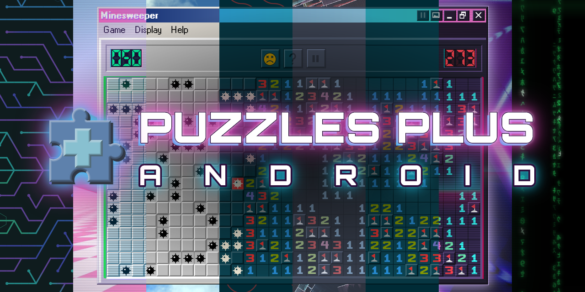
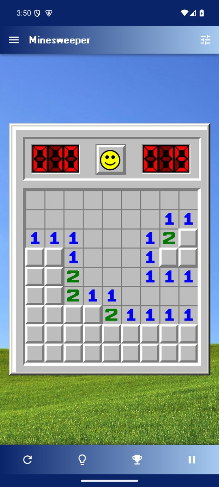
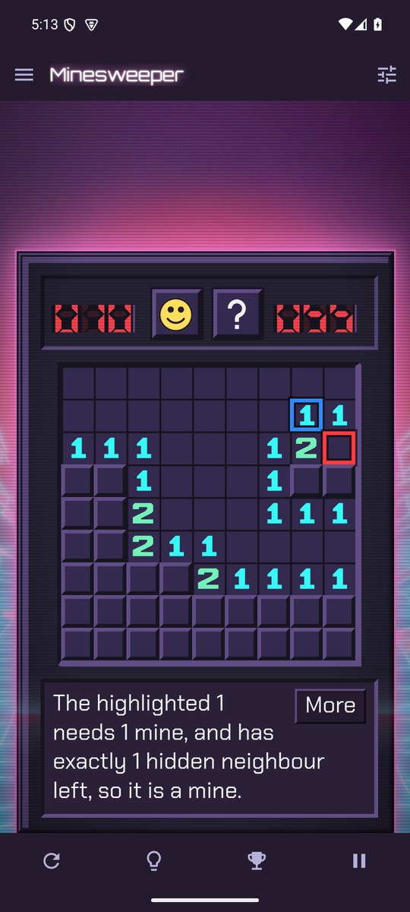
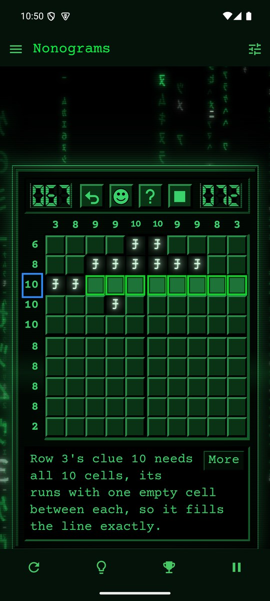
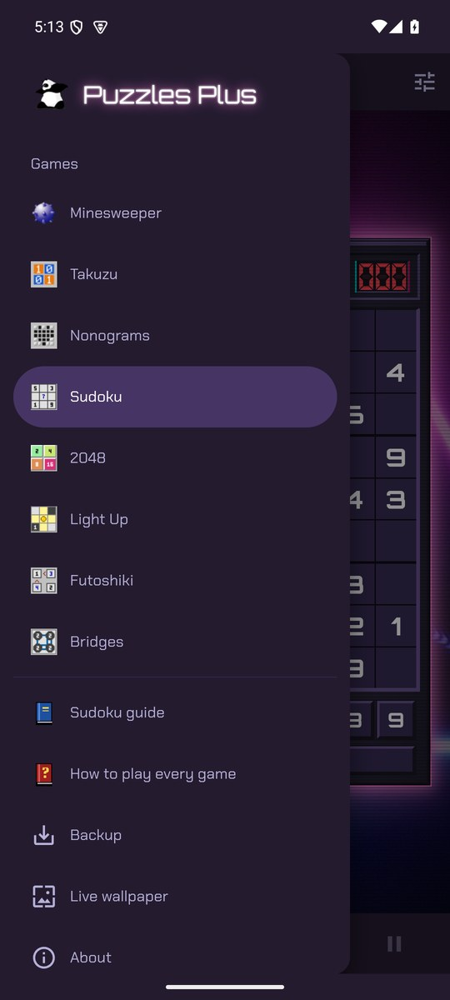
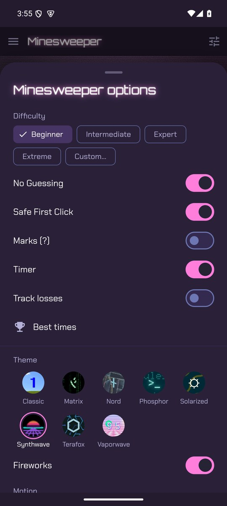
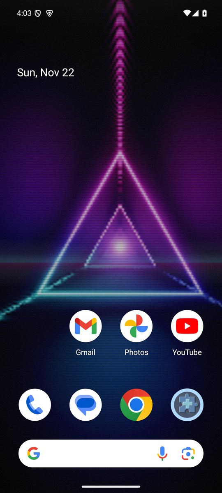
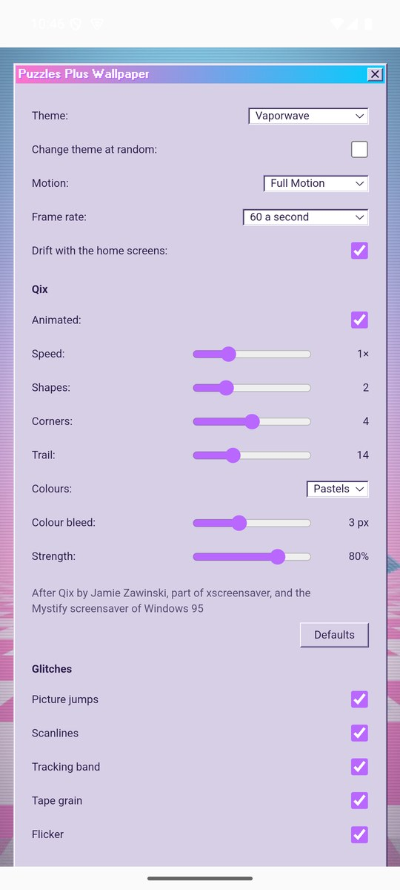
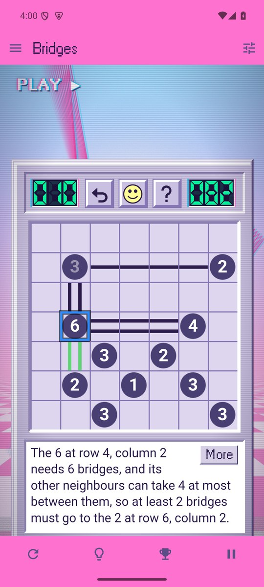

<p align="center"></p>

# Puzzles Plus for Android

**A live wallpaper for Android, and eight puzzle games to go with it.** Puzzles Plus brings the animated themes of the [Puzzles Plus website](https://fexofenadine.github.io/puzzlesplus/) ([source](https://github.com/fexofenadine/puzzlesplus)) to your home screen: Synthwave's neon shader under VHS scanlines and glitches, Matrix code rain, Vaporwave's worn tape and the rest of its eight themes, drifting as you swipe between home screens, with the theme, background options, glitches and frame rate set to taste. The app is also the games themselves, in a Windows 95 style with hints that explain their reasoning and boards you can solve by logic alone: Minesweeper, Takuzu, Sudoku, Futoshiki, Nonograms, Light Up, Bridges and 2048, with guides, best times and everything inside the app, so it plays offline.

**[Download the latest release](https://github.com/fexofenadine/puzzlesplus-android/releases/latest)**

| Minesweeper on Classic                                          | Synthwave, with a hint                                              | Nonograms on Matrix, with a hint                                 | The menu                                                    |
| --------------------------------------------------------------- | ------------------------------------------------------------------- | ---------------------------------------------------------------- | ----------------------------------------------------------- |
|  |  |         |                         |
| **Options**                                                     | **The live wallpaper, Synthwave, on the home screen**               | **The wallpaper's settings**                                     | **Bridges on Vaporwave, with a hint**                       |
|                             |               |  |  |

## Installing

1. On your phone, open the [latest release](https://github.com/fexofenadine/puzzlesplus-android/releases/latest) and download `puzzlesplus-<version>.apk`.
2. Open the downloaded file. Android asks you to allow installs from your browser or file manager the first time.
3. Updates install over the version you have and keep your settings and best times.

Android 6 or later. Each release lists its APK's SHA-256, so you can check the download.

## On a phone

- **The game fills the screen** between a top bar in the theme's colours (the menu, the game's name and its options) and a bottom bar with new game, hint, best times and pause; held sideways the two run down the sides. Wide boards turn on their side in portrait, and two fingers pinch a board bigger, with a button to fit it again.
- **The menu** (the button at the top left) lists the eight games, any games you saved to resume later, the game's guide, how to play every game, Backup, Live wallpaper and About.
- **Options** (the button at the top right) hold the game's difficulty, size and options (Nonograms adds Procedural, Symmetric and Choose picture), then the eight themes, **Fireworks**, **Motion** (system, reduced or full), a slider for the window's opacity, Animated background, Hide window, Board without frame, the background settings and, on Synthwave, Vaporwave and Matrix, **Glitches**, which switches each screen effect on or off. The look follows the theme: Windows 95 on Classic, material design on the others.
- **Fireworks** in the theme's colours go up when you win, until the next game starts.
- **Live wallpaper**: any theme's animated background on the home screen, with its scanlines, tape look and glitches. Open it from the menu, or pick Puzzles Plus among the phone's live wallpapers. Its settings choose the theme or a random one every few minutes, the background's options, each glitch, the frame rate (60 fps at first) and a drift as you swipe between home screens. It draws nothing while an app covers the home screen or the screen is off.
- **The back button** closes the menu or a dialog first, then leaves the app; a guide's back goes to its game.
- The phone's status and navigation bars take the theme's colour, and the system font size grows the menus, bars and dialogs but leaves the games' pixel layout alone.
- **Resume**: a game in progress comes back paused after the app is closed, and a **Timer** option turns the clock off (and best times with it).
- No taskbar, Start menu, boss key or window buttons: those belong to the website's desktop.

Everything else, from the rules to every solving technique, is in each game's guide, in the app's menu or on the website: [Minesweeper](https://fexofenadine.github.io/puzzlesplus/minesweeper/guide/), [Takuzu](https://fexofenadine.github.io/puzzlesplus/takuzu/guide/), [Nonograms](https://fexofenadine.github.io/puzzlesplus/nonograms/guide/), [Sudoku](https://fexofenadine.github.io/puzzlesplus/sudoku/guide/), [2048](https://fexofenadine.github.io/puzzlesplus/2048/guide/), [Light Up](https://fexofenadine.github.io/puzzlesplus/lightup/guide/), [Futoshiki](https://fexofenadine.github.io/puzzlesplus/futoshiki/guide/) and [Bridges](https://fexofenadine.github.io/puzzlesplus/bridges/guide/).

## Building

The app is the website's code, built in a phone mode and wrapped with [Capacitor](https://capacitorjs.com). It needs Node with Yarn, JDK 21 and the Android SDK (platform 35).

```sh
yarn                      #install dependencies
yarn start:android        #dev server in phone mode
yarn build:android        #web files in www/
npx cap sync android      #copy them into the android project
cd android
gradlew assembleDebug     #app/build/outputs/apk/debug/puzzlesplus-<version>-debug.apk (installs beside the release as Puzzles Plus Debug)
gradlew assembleRelease   #app/build/outputs/apk/release/puzzlesplus-<version>.apk
```

The version comes from `package.json`. Release builds are signed with the key that `~/.android/puzzlesplus-release.properties` names (`storeFile`, `storePassword`, `keyAlias`, `keyPassword`), which stays out of the repository. The icon, launcher icons and splash screens are drawn by `src/shell/icon.py`.

The phone layer is kept to a few files (`src/shell/phone.js`, `src/shell/PhoneBar.jsx`, each game's `PhoneMenu.jsx`, `capacitor.config.json` and `android/`), so changes to the games are made in [fexofenadine/puzzlesplus](https://github.com/fexofenadine/puzzlesplus) and merged in from there. The live wallpaper is the website's screensaver page (`src/screensaver`) in a webview, drawn by `PuzzlesWallpaper.java` with its settings in `WallpaperSettings.java`.

`tools/droid.py` drives the debug build on an emulator or phone, and `tools/readme-shots.py` retakes the pictures above with it.

## Credits

The games, themes and their credits are those of [Puzzles Plus](https://github.com/fexofenadine/puzzlesplus#credits), itself a fork of [frenzzy/minesweeper](https://github.com/frenzzy/minesweeper) by Vladimir Kutepov. Released under the MIT licence.
