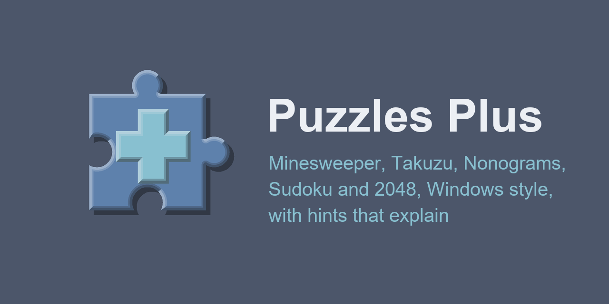
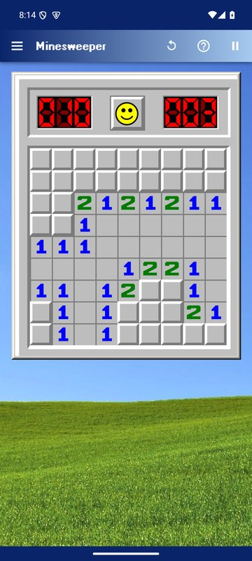
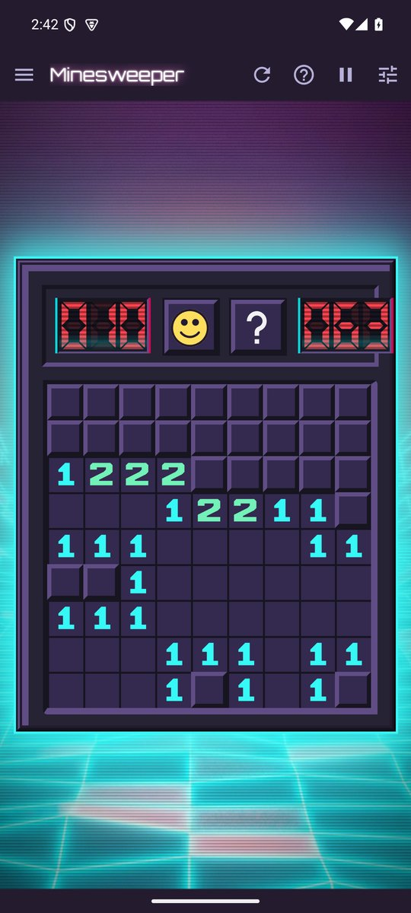
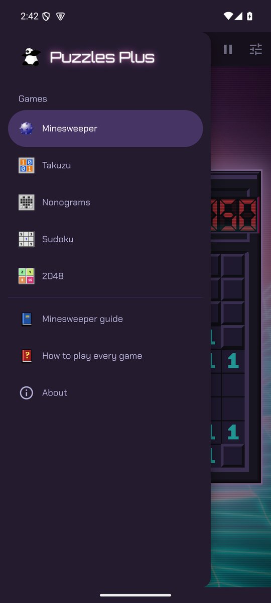
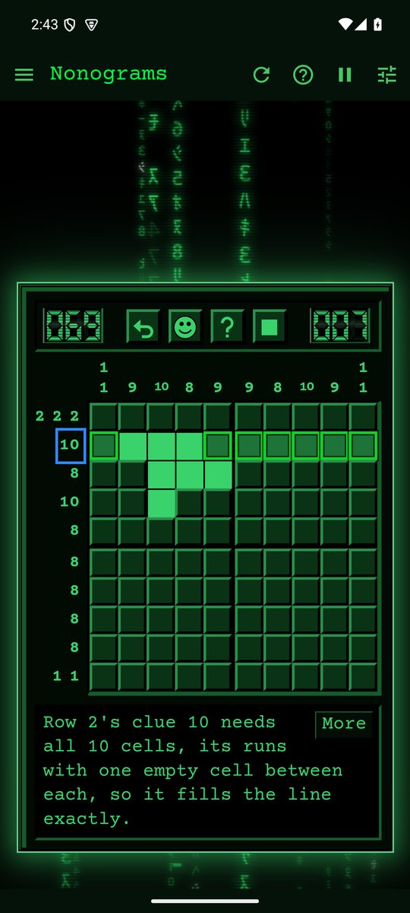

<p align="center"></p>

# Puzzles Plus for Android

Minesweeper, Takuzu, Nonograms, Sudoku and 2048 in a Windows 95 style, with hints that explain their reasoning and boards you can solve by logic alone, as an Android app. It is the [Puzzles Plus website](https://fexofenadine.github.io/puzzlesplus/) made for phones: the same games, six themes and animated backgrounds, guides and best times, all inside the app so it plays offline.

**[Download the latest release](https://github.com/fexofenadine/puzzlesplus-android/releases/latest)**

| Minesweeper on Classic                                          | Synthwave                                                           | The menu, on Matrix                            | Nonograms on Matrix                                       |
| --------------------------------------------------------------- | ------------------------------------------------------------------- | ---------------------------------------------- | --------------------------------------------------------- |
|  |  |  |  |

## Installing

1. On your phone, open the [latest release](https://github.com/fexofenadine/puzzlesplus-android/releases/latest) and download `puzzlesplus-<version>.apk`.
2. Open the downloaded file. Android asks you to allow installs from your browser or file manager the first time.
3. Updates install over the version you have and keep your settings and best times.

Android 6 or later. Each release lists its APK's SHA-256, so you can check the download.

## On a phone

- **The game fills the screen** under a top bar in the theme's colours, with the menu, new game, hint and pause. Wide boards turn on their side in portrait.
- **The menu** has the five games, new game, hint and undo, difficulty and size as buttons, each game's options, the six themes, background settings, the guides and About.
- **The back button** closes the menu or a dialog first, then leaves the app; a guide's back goes to its game.
- The phone's status and navigation bars take the theme's colour, and the system font size leaves the games' pixel layout alone; the games have their own zoom.
- **Resume**: a game in progress comes back paused after the app is closed, and a **Timer** option turns the clock off (and best times with it).
- No taskbar, Start menu, boss key or window buttons: those belong to the website's desktop.

Everything else, from the rules to every solving technique, is in each game's guide, in the app's menu or on the website: [Minesweeper](https://fexofenadine.github.io/puzzlesplus/minesweeper/guide/), [Takuzu](https://fexofenadine.github.io/puzzlesplus/takuzu/guide/), [Nonograms](https://fexofenadine.github.io/puzzlesplus/nonograms/guide/), [Sudoku](https://fexofenadine.github.io/puzzlesplus/sudoku/guide/) and [2048](https://fexofenadine.github.io/puzzlesplus/2048/guide/).

## Building

The app is the website's code, built in a phone mode and wrapped with [Capacitor](https://capacitorjs.com). It needs Node with Yarn, JDK 21 and the Android SDK (platform 35).

```sh
yarn                      #install dependencies
yarn start:android        #dev server in phone mode
yarn build:android        #web files in www/
npx cap sync android      #copy them into the android project
cd android
gradlew assembleDebug     #app/build/outputs/apk/debug/puzzlesplus-<version>-debug.apk
gradlew assembleRelease   #app/build/outputs/apk/release/puzzlesplus-<version>.apk
```

The version comes from `package.json`. Release builds are signed with the key that `~/.android/puzzlesplus-release.properties` names (`storeFile`, `storePassword`, `keyAlias`, `keyPassword`), which stays out of the repository. The icon, launcher icons and splash screens are drawn by `src/shell/icon.py`.

The phone layer is kept to a few files (`src/shell/phone.js`, `src/shell/PhoneBar.jsx`, each game's `PhoneMenu.jsx`, `capacitor.config.json` and `android/`), so changes to the games are made in [fexofenadine/puzzlesplus](https://github.com/fexofenadine/puzzlesplus) and merged in from there.

## Credits

The games, themes and their credits are those of [Puzzles Plus](https://github.com/fexofenadine/puzzlesplus#credits), itself a fork of [frenzzy/minesweeper](https://github.com/frenzzy/minesweeper) by Vladimir Kutepov. Released under the MIT licence.
